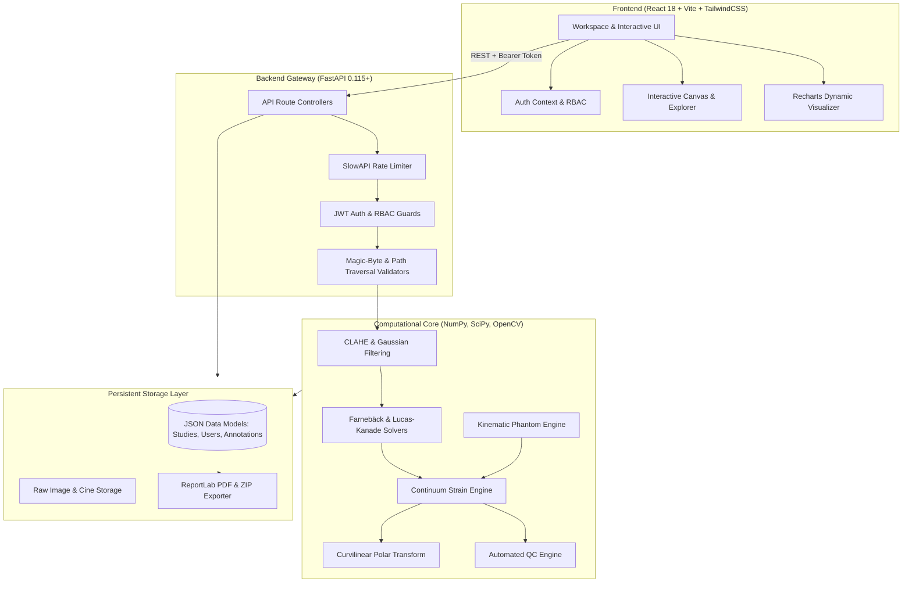

# Cardiac Deformation Lab

> **Image-Based Cardiac Deformation Mapping Using Mathematical Motion and Strain Analysis**  
> *A Computational Biomechanics Research Prototype for Two-Dimensional In-Plane Myocardial Kinematic Estimation*

[](CHANGELOG.md)
[](LICENSE)
[](https://www.python.org/)
[](https://fastapi.tiangolo.com/)
[](https://react.dev/)
[](https://tailwindcss.com/)
[](docs/PROJECT_STATUS.md)

---

## Table of Contents
1. [Scientific Context & Purpose](#1-scientific-context--purpose)
2. [Mandatory Non-Clinical Research Disclaimer](#2-mandatory-non-clinical-research-disclaimer)
3. [Key Capabilities & Feature Highlights](#3-key-capabilities--feature-highlights)
4. [System Architecture](#4-system-architecture)
5. [Continuum Mechanics & Mathematical Methodology](#5-continuum-mechanics--mathematical-methodology)
6. [Optical Flow & Motion Estimation](#6-optical-flow--motion-estimation)
7. [Cauchy Strain Tensor & Invariants](#7-cauchy-strain-tensor--invariants)
8. [Principal Strain Decomposition](#8-principal-strain-decomposition)
9. [Polar Coordinate Transformation (Radial & Circumferential)](#9-polar-coordinate-transformation-radial--circumferential)
10. [Temporal Sequence Analysis & Cine Loop Tracking](#10-temporal-sequence-analysis--cine-loop-tracking)
11. [Region of Interest (ROI) Masking & Automatic Tracking](#11-region-of-interest-roi-masking--automatic-tracking)
12. [Spatial Calibration & Physical Metric Units](#12-spatial-calibration--physical-metric-units)
13. [Automated Quality Control (QC) Layer](#13-automated-quality-control-qc-layer)
14. [Longitudinal & Multi-Session Study Analysis](#14-longitudinal--multi-session-study-analysis)
15. [Advanced Statistical Research Analytics](#15-advanced-statistical-research-analytics)
16. [Synthetic Phantom Generator & Quantitative Benchmark](#16-synthetic-phantom-generator--quantitative-benchmark)
17. [Real-Image Reference Annotation Workflow](#17-real-image-reference-annotation-workflow)
18. [Research Workspace & Role-Based Access Control (RBAC)](#18-research-workspace--role-based-access-control-rbac)
19. [Interactive Analysis Explorer](#19-interactive-analysis-explorer)
20. [Publication-Ready Research Reports & Scientific Data Packages](#20-publication-ready-research-reports--scientific-data-packages)
21. [Production Hardening, Performance & Security](#21-production-hardening-performance--security)
22. [Complete REST API Specification](#22-complete-rest-api-specification)
23. [Frontend Architecture & Client Routing](#23-frontend-architecture--client-routing)
24. [Technology Stack & Core Dependencies](#24-technology-stack--core-dependencies)
25. [Prerequisites & System Requirements](#25-prerequisites--system-requirements)
26. [Local Installation & Setup Guide](#26-local-installation--setup-guide)
27. [Quick Start & Execution Guide](#27-quick-start--execution-guide)
28. [Automated Test Suite Verification](#28-automated-test-suite-verification)
29. [Live Demonstration Walkthrough](#29-live-demonstration-walkthrough)
30. [Reproducibility & Scientific Manifest](#30-reproducibility--scientific-manifest)
31. [Data Persistence & Storage Model](#31-data-persistence--storage-model)
32. [Physical Limitations & Assumptions](#32-physical-limitations--assumptions)
33. [Docker & Container Deployment Blueprint](#33-docker--container-deployment-blueprint)
34. [Repository Directory Structure](#34-repository-directory-structure)
35. [Contributing, Citation & License](#35-contributing-citation--license)
36. [Team Collaboration & Git Workflow](#36-team-collaboration--git-workflow)

---

## 1. Scientific Context & Purpose

Quantification of regional myocardial deformation (strain and strain rate) provides critical biomechanical insights into cardiac mechanics beyond global volumetric indices such as ejection fraction. The **Cardiac Deformation Lab** is an end-to-end computational research workstation engineered to calculate, visualize, validate, and benchmark in-plane myocardial deformation fields from pairs or temporal cine sequences of standard cardiac imaging modalities (e.g., echocardiography and cardiovascular magnetic resonance).

By bridging classical continuum solid mechanics with advanced computer vision algorithms (dense polynomial expansion optical flow and pyramidal Lucas-Kanade tracking), the platform provides researchers with an open, reproducible, and verifiable environment for analyzing cardiac kinematics.

---

## 2. Mandatory Non-Clinical Research Disclaimer

> [!CAUTION]
> **RESEARCH PROTOTYPE NOTICE & NON-CLINICAL STATEMENT**  
> *This document and the associated software present computational image-derived measurements generated by a research prototype. The results are not medical diagnoses, prognoses, treatment recommendations, or clinical findings. Optical-flow-derived displacement represents apparent image motion and does not automatically establish true physical tissue motion. This software is not cleared or approved by any medical regulatory agency and must NEVER be used for clinical decision-making or patient management.*

---

## 3. Key Capabilities & Feature Highlights

- **Dual-Frame & Cine Sequence Analysis**: Instantaneous pair-wise deformation mapping and multi-frame temporal cine loop processing.
- **Full Cauchy Strain Tensor**: Rigorous spatial gradient evaluation generating normal ($\varepsilon_{xx}, \varepsilon_{yy}$) and shear ($\varepsilon_{xy}$) strain fields.
- **Eigenvalue Decomposition**: Principal tensile ($\varepsilon_1$) and compressive ($\varepsilon_2$) strains with principal orientation angles ($\theta_p$).
- **Curvilinear Ventricular Mapping**: Automated coordinate transformation to anatomical radial ($\varepsilon_{rr}$) thickening and circumferential ($\varepsilon_{\theta\theta}$) shortening.
- **Dynamic Pyramidal ROI Tracking**: Automated propagation of user-defined rectangular, elliptical, and freehand polygonal myocardial masks across cardiac cycles.
- **Physical Calibration**: True dimensional scaling ($\text{mm}, \text{mm/s}$) through user-specified spatial and temporal intervals.
- **Automated Computational Quality Control (QC)**: 8-factor technical fidelity scoring system ($0\text{--}100$) flagging artifacts, clipping, and motion coherence anomalies.
- **Multi-Session Longitudinal & Statistical Analytics**: Cross-session trend regression, variability indices, effect sizes, and correlation matrices.
- **Synthetic Phantom Validation**: Exact analytical kinematic ground-truth benchmarking yielding Endpoint Error (EPE), RMSE, and MAE metrics.
- **Manual Reference Annotation Workflow**: Expert contour benchmarking for measuring algorithmic agreement on real patient imaging.
- **Interactive Multi-Layer Explorer**: High-performance canvas viewer with cross-sectional line profiling and interactive histogram filtering.
- **Publication Reports & Data Archives**: Vector PDF generation and one-click ZIP scientific packages bundling 300 DPI figures and calibrated CSV tables.

---

## 4. System Architecture

The Cardiac Deformation Lab is architected as a modular, decoupled client-server application emphasizing zero-dependency local setup, reproducible data persistence, and computational performance.



---

## 5. Continuum Mechanics & Mathematical Methodology

The platform models tissue deformation using continuum kinematics. Let $\boldsymbol{X} = [X, Y]^T$ denote coordinates in the undeformed reference state, and $\boldsymbol{x} = [x, y]^T$ the deformed coordinates at time $t$:

$$\boldsymbol{x} = \boldsymbol{X} + \boldsymbol{d}(\boldsymbol{X}, t)$$

where $\boldsymbol{d} = [u, v]^T$ represents the displacement vector field. The spatial deformation gradient $\boldsymbol{F}$ is:

$$\boldsymbol{F} = \frac{\partial \boldsymbol{x}}{\partial \boldsymbol{X}} = \boldsymbol{I} + \nabla \boldsymbol{d}$$

---

## 6. Optical Flow & Motion Estimation

Dense displacement estimation relies on Gunnar Farnebäck’s polynomial expansion algorithm. Consecutive frame neighborhoods are approximated quadratically:

$$f(\boldsymbol{x}) \sim \boldsymbol{x}^T \boldsymbol{A} \boldsymbol{x} + \boldsymbol{b}^T \boldsymbol{x} + c$$

Assuming displacement $\boldsymbol{d}$, equating coefficients across image frames under the brightness constancy constraint ($\frac{dI}{dt} = 0$) produces a multi-scale linear solution evaluated across an image pyramid.

---

## 7. Cauchy Strain Tensor & Invariants

Under infinitesimal displacement gradients ($\|\nabla \boldsymbol{d}\| \ll 1$), the symmetric infinitesimal strain tensor $\boldsymbol{\varepsilon}$ is formulated as:

$$\boldsymbol{\varepsilon} = \frac{1}{2}\left( \nabla \boldsymbol{d} + (\nabla \boldsymbol{d})^T \right) = \begin{bmatrix} \varepsilon_{xx} & \varepsilon_{xy} \\ \varepsilon_{xy} & \varepsilon_{yy} \end{bmatrix}$$

- **Normal Strains**: $\varepsilon_{xx} = \frac{\partial u}{\partial x}$, $\varepsilon_{yy} = \frac{\partial v}{\partial y}$
- **Shear Strain**: $\varepsilon_{xy} = \frac{1}{2}\left(\frac{\partial u}{\partial y} + \frac{\partial v}{\partial x}\right)$
- **Equivalent (von Mises) Strain**: $\varepsilon_{eq} = \sqrt{\frac{2}{3}(\varepsilon_{xx}^2 + \varepsilon_{yy}^2 + 2\varepsilon_{xy}^2)}$
- **Volumetric Area Change**: $\varepsilon_{vol} = \text{tr}(\boldsymbol{\varepsilon}) = \varepsilon_{xx} + \varepsilon_{yy}$

---

## 8. Principal Strain Decomposition

Eigenvalue decomposition of $\boldsymbol{\varepsilon}$ yields invariant extreme normal strains independent of Cartesian orientation:

$$\varepsilon_{1,2} = \frac{\varepsilon_{xx} + \varepsilon_{yy}}{2} \pm \sqrt{\left(\frac{\varepsilon_{xx} - \varepsilon_{yy}}{2}\right)^2 + \varepsilon_{xy}^2}$$

$$\theta_p = \frac{1}{2}\arctan\left(\frac{2\varepsilon_{xy}}{\varepsilon_{xx} - \varepsilon_{yy}}\right)$$

$\varepsilon_1$ represents maximum tensile expansion; $\varepsilon_2$ represents maximum compressive shortening.

---

## 9. Polar Coordinate Transformation (Radial & Circumferential)

Given a ventricular centroid $(x_c, y_c)$, local coordinate rotation projects Cartesian tensors onto anatomical axes:

$$\boldsymbol{R}(\theta) = \begin{bmatrix} \cos\theta & \sin\theta \\ -\sin\theta & \cos\theta \end{bmatrix}, \quad \boldsymbol{\varepsilon}_{\text{polar}} = \boldsymbol{R} \boldsymbol{\varepsilon} \boldsymbol{R}^T$$

- **Radial Strain ($\varepsilon_{rr}$)**: $\varepsilon_{rr} = \varepsilon_{xx} \cos^2\theta + \varepsilon_{yy} \sin^2\theta + 2\varepsilon_{xy}\sin\theta\cos\theta$
- **Circumferential Strain ($\varepsilon_{\theta\theta}$)**: $\varepsilon_{\theta\theta} = \varepsilon_{xx} \sin^2\theta + \varepsilon_{yy} \cos^2\theta - 2\varepsilon_{xy}\sin\theta\cos\theta$

---

## 10. Temporal Sequence Analysis & Cine Loop Tracking

Multi-frame cine analysis processes sequences of frames $\{I_0, I_1, \dots, I_T\}$. Tracking accumulates frame-to-frame Lagrangian trajectories, deriving continuous curves for:
- Frame-by-frame mean displacement and velocity
- Instantaneous strain rate: $\dot{\varepsilon}(t) = \frac{d\varepsilon}{dt}$
- Time-to-peak shortening and regional dyssynchrony markers.

---

## 11. Region of Interest (ROI) Masking & Automatic Tracking

Users can isolate specific myocardial walls (septal, lateral, anterior, inferior) using interactive geometrical masks:
- **Rectangular**: Specified by $(x_0, y_0, w, h)$
- **Elliptical**: Specified by center $(x_c, y_c)$ and semi-axes $(a, b)$
- **Polygonal**: Arbitrary $N$-vertex closed contours evaluated via winding number algorithms.

Masks are dynamically propagated across cine sequences using Lucas-Kanade optical flow with spatial image pyramids.

---

## 12. Spatial Calibration & Physical Metric Units

When spatial resolution ($s_x, s_y$ in $\text{mm/pixel}$) and temporal frame interval ($\Delta t$ in seconds) are configured:
- Displacement: $\boldsymbol{d}_{\text{mm}} = [u \cdot s_x, \; v \cdot s_y]^T$
- Velocity: $\boldsymbol{v}_{\text{mm/s}} = \frac{\boldsymbol{d}_{\text{mm}}}{\Delta t}$
- Strain values remain invariant under uniform isotropic scaling, maintaining rigorous mechanical definition.

---

## 13. Automated Quality Control (QC) Layer

The QC layer computes an objective technical fidelity score $S_{\text{QC}} \in [0, 100]$ composed of 8 weighted sub-indices:
1. **Dynamic Range & Entropy**: Detection of underexposed or over-saturated frames.
2. **Motion Magnitude & Dispersion**: Detection of frozen frames ($< 0.1 \text{ px}$) or unphysical velocities ($> 100 \text{ px}$).
3. **Vector Coherence**: Spatial cosine similarity across neighboring displacement vectors.
4. **Strain Gradient Regularity**: Penalty on high-frequency spatial derivative spikes.
5. **Coverage Integrity**: Absence of uncomputable $\text{NaN}$ or $\text{Inf}$ regions within the mask.
6. **Calibration Completeness**: Availability of verified physical calibration metadata.
7. **Temporal Continuity**: Absence of sudden non-physiological tracking jumps.
8. **High-Frequency Noise**: Estimated via Laplacian spatial variance.

---

## 14. Longitudinal & Multi-Session Study Analysis

Enables tracking biomechanical progression across multiple sessions or timepoints for the same subject or animal model:
- Baseline vs. follow-up paired comparison
- Longitudinal trajectory plots with automated trend lines
- Percent change ($\Delta\%$) across key parameters ($\varepsilon_1, \varepsilon_2, \varepsilon_{rr}, \varepsilon_{\theta\theta}$).

---

## 15. Advanced Statistical Research Analytics

Built-in statistical algorithms provide research-grade data modeling:
- **Descriptive Distribution**: Mean, median, standard deviation, IQR, and 5th/95th percentiles.
- **Effect Size**: Cohen's $d$ quantification between baseline and follow-up states.
- **Correlation Engine**: Pearson parametric and Spearman rank-order correlations across deformation metrics.

---

## 16. Synthetic Phantom Generator & Quantitative Benchmark

To validate algorithm implementation without relying on noisy clinical data, the platform includes a kinematic synthetic deformation generator:
- Simulates realistic myocardial rings with controllable affine contraction, twist, and shear.
- Compares computed optical flow against exact analytical ground-truth fields.
- Reports **Endpoint Error (EPE)**, **Root Mean Square Error (RMSE)**, and **Mean Absolute Error (MAE)**.

---

## 17. Real-Image Reference Annotation Workflow

Provides an interactive labeling interface for expert-guided validation:
- Place landmark reference points and myocardial wall contours on real clinical images.
- Quantitatively benchmark automated optical flow tracking trajectories against human manual references.
- Track inter-observer variability across multi-investigator teams.

---

## 18. Research Workspace & Role-Based Access Control (RBAC)

The workspace provides isolated multi-user environments:
- **Authentication**: JWT bearer tokens with bcrypt credential hashing.
- **Roles**:
  - `admin`: Full administrative access to users, studies, and system configurations.
  - `researcher`: Create and manage studies, run analyses, and generate reports.
  - `reviewer`: Read-only access to inspect analyses, quality scores, and export packages.
- **Object-Level Security**: Strict user-to-study ownership isolation preventing unauthorized data access.

---

## 19. Interactive Analysis Explorer

Accessible at `/explorer/:analysisId`, the Analysis Explorer provides advanced scientific visualization:
- Synchronized multi-layer rendering (raw image, displacement vectors, strain heatmaps).
- Interactive cross-sectional line profile extraction displaying 1D strain gradients across tissue walls.
- Dynamic color map adjustments and intensity histogram thresholding.

---

## 20. Publication-Ready Research Reports & Scientific Data Packages

- **Automated PDF Reports**: Generated via ReportLab, incorporating multi-panel high-resolution figures, calculation parameters, QC scoring breakdown, and mandatory non-clinical disclaimers.
- **Comprehensive ZIP Export Packages**: Includes raw displacement matrices, strain tensors, metadata manifests (`analysis_metadata.json`), and 300 DPI publication figures.

---

## 21. Production Hardening, Performance & Security

- **Rate Limiting**: Integrated SlowAPI throttling against denial-of-service on computationally heavy endpoints.
- **File Validation**: Strict magic-byte inspection verifying authentic PNG/JPEG image headers.
- **Path Traversal Protection**: Canonical path resolution preventing arbitrary file read/write.
- **Caching**: LRU caching of mathematical transformations to minimize redundant re-computation.

---

## 22. Complete REST API Specification

| Method | Endpoint | Description | Auth Required |
| :--- | :--- | :--- | :---: |
| `GET` | `/health` | System health check and uptime status | No |
| `GET` | `/disclaimer` | Mandatory non-clinical disclaimer text | No |
| `POST` | `/api/auth/register` | Register new research user account | No |
| `POST` | `/api/auth/login` | Authenticate and obtain JWT access token | No |
| `GET` | `/api/auth/me` | Fetch authenticated user profile & role | Yes |
| `POST` | `/api/upload` | Upload and validate single or paired images | Yes |
| `POST` | `/api/motion/displacement` | Compute dense optical flow displacement field | Yes |
| `POST` | `/api/motion/strain` | Compute infinitesimal Cauchy strain tensor | Yes |
| `POST` | `/api/motion/principal-strain` | Compute principal strains ($\varepsilon_1, \varepsilon_2, \theta_p$) | Yes |
| `POST` | `/api/motion/advanced-metrics` | Compute equivalent and volumetric strains | Yes |
| `POST` | `/api/motion/radial-circumferential`| Transform strain to polar cylindrical coordinates | Yes |
| `POST` | `/api/temporal/analyze` | Multi-frame cine loop deformation analysis | Yes |
| `POST` | `/api/roi/mask` | Apply rectangular, elliptical, or polygonal mask | Yes |
| `POST` | `/api/calibration/apply` | Calibrate displacement and strain to physical units | Yes |
| `POST` | `/api/qc/evaluate` | Evaluate technical quality control score and flags | Yes |
| `GET` | `/api/studies/` | List all research studies for active user | Yes |
| `POST` | `/api/studies/` | Create a new isolated research study | Yes |
| `GET` | `/api/longitudinal/{study_id}` | Generate longitudinal progression summary | Yes |
| `POST` | `/api/statistics/correlations` | Compute correlation matrix across study metrics | Yes |
| `POST` | `/api/synthetic/generate` | Generate controllable kinematic phantom frames | Yes |
| `POST` | `/api/synthetic/benchmark` | Run quantitative accuracy benchmark against ground truth | Yes |
| `POST` | `/api/annotations/` | Create manual reference landmark / contour annotation | Yes |
| `GET` | `/api/annotations/{id}` | Retrieve reference annotation record | Yes |
| `POST` | `/api/reports/generate` | Generate publication-ready PDF research report | Yes |
| `GET` | `/api/reports/download/{id}` | Download generated research report PDF | Yes |
| `GET` | `/api/reports/export-package/{id}` | Download complete ZIP scientific data archive | Yes |

---

## 23. Frontend Architecture & Client Routing

Built with **React 18**, **Vite**, and **TailwindCSS**, the single-page application features responsive, stateful navigation:

| Route | View Component | Primary Function |
| :--- | :--- | :--- |
| `/` | `Dashboard.jsx` | Research workspace overview, recent studies, metrics |
| `/login` | `Login.jsx` | User authentication and JWT session acquisition |
| `/studies` | `Studies.jsx` | Study management, multi-session organization |
| `/analysis` | `Analysis.jsx` | Frame upload, preprocessing, motion & strain computation |
| `/results` | `Results.jsx` | Interactive deformation maps, vector quivers, QC panels |
| `/temporal` | `Temporal.jsx` | Multi-frame cine loop playback and temporal curves |
| `/explorer/:id` | `AnalysisExplorer.jsx` | High-performance multi-layer viewer and line profiles |
| `/comparison` | `Comparison.jsx` | Side-by-side comparative analysis between sessions |
| `/synthetic` | `SyntheticValidation.jsx` | Kinematic phantom generation and benchmark metrics |
| `/real-validation`| `RealValidation.jsx` | Manual landmark annotation and reference benchmarking |
| `/reports` | `Reports.jsx` | PDF report generator and ZIP archive downloader |

---

## 24. Technology Stack & Core Dependencies

### Backend
- **Python 3.10+**
- **FastAPI 0.115+**: High-performance asynchronous API framework.
- **OpenCV (cv2) 4.10+**: Computer vision, Farnebäck optical flow, Lucas-Kanade tracking.
- **NumPy & SciPy**: Tensor calculus, gradient evaluation, eigenvalue decomposition.
- **ReportLab 4.2+**: Scientific vector PDF generation.
- **SlowAPI**: Token-bucket rate limiting.
- **PyJWT & Passlib (bcrypt)**: Secure authentication and password hashing.

### Frontend
- **React 18 & Vite 5**: Modern reactive frontend client.
- **TailwindCSS v4**: Responsive utility styling.
- **Lucide React**: Clean scientific iconography.
- **Recharts**: Responsive charting of temporal strain and longitudinal trends.

---

## 25. Prerequisites & System Requirements

- **Operating System**: Windows 10/11, Ubuntu 20.04+, or macOS 12+
- **Python**: Version `3.10` or higher (`python --version`)
- **Node.js**: Version `18.x` or `20.x` LTS (`node --version`)
- **Memory**: Minimum $4\text{ GB}$ RAM ($8\text{ GB}$ recommended for high-resolution cine loops).
- **Disk Space**: $500\text{ MB}$ free storage.

---

## 26. Local Installation & Setup Guide

### 1. Clone Repository
```bash
git clone https://github.com/your-org/Cardiac-Deformation-Lab.git
cd Cardiac-Deformation-Lab
```

### 2. Backend Setup
```bash
cd backend
python -m venv venv

# On Windows:
.\venv\Scripts\activate
# On Linux/macOS:
source venv/bin/activate

pip install -r requirements.txt
```

### 3. Frontend Setup
```bash
cd ../frontend
npm install
```

---

## 27. Quick Start & Execution Guide

### Start the Backend Service
```bash
cd backend
# With virtual environment activated:
uvicorn app.main:app --host 127.0.0.1 --port 8000 --reload
```
*Interactive Swagger documentation available at: `http://127.0.0.1:8000/docs`*

### Start the Frontend Client
```bash
cd frontend
npm run dev
```
*Access the workspace application in your browser at: `http://localhost:5173`*

---

## 28. Automated Test Suite Verification

Execute the comprehensive master validation suite testing all 16 functional modules:

```bash
cd backend
.\venv\Scripts\python.exe test_complete_suite_step11_20.py
```

### Expected Output:
```text
================================================================================
STEP 11.20: MASTER END-TO-END VALIDATION & TEST SUITE
================================================================================
[1/13] Health & Version Endpoints                    --> [PASS]
[2/13] Auth & Role-Based Access Control (RBAC)       --> [PASS]
[3/13] File Upload Security & Magic-Byte Validation  --> [PASS]
[4/13] Motion & Strain Computation Pipeline          --> [PASS]
[5/13] ROI Analysis & Spatial Calibration            --> [PASS]
[6/13] Studies Management & Data Ownership           --> [PASS]
[7/13] Analysis Persistence & Quality Control (QC)   --> [PASS]
[8/13] Longitudinal & Statistical Modeling           --> [PASS]
[9/13] Synthetic Phantom Generation & Benchmark      --> [PASS]
[10/13] Manual Annotation CRUD & Reference Benchmark --> [PASS]
[11/13] PDF Research Reports & Scientific Exports    --> [PASS]
[12/13] Analysis Explorer & Quantitative Comparison  --> [PASS]
[13/13] Error Handling & Input Validation Standards  --> [PASS]
--------------------------------------------------------------------------------
OVERALL SUITE RESULTS: 13 / 13 SUITES PASSED (100% SUCCESS)
================================================================================
```

---

## 29. Live Demonstration Walkthrough

For an 8-to-10 minute presentation or scientific demonstration, follow the detailed script in [`docs/DEMO_GUIDE.md`](docs/DEMO_GUIDE.md):
1. **Login & RBAC**: Multi-user isolation and role verification.
2. **Study Creation**: Organizing cine data into dedicated research studies.
3. **Motion & Strain Analysis**: Computing vector fields and tensor invariants.
4. **ROI Masking & Calibration**: Real-time physical metric updates ($\text{mm}, \text{mm/s}$).
5. **Quality Control**: Automated technical quality breakdown.
6. **Synthetic & Real Validation**: Ground-truth benchmarking and human reference annotation.
7. **Explorer & Reporting**: Multi-layer inspection and PDF report export.
8. **Limitations Review**: Open discussion of 2D optical flow constraints.

---

## 30. Reproducibility & Scientific Manifest

Every analysis run stores a comprehensive metadata manifest ensuring complete scientific reproducibility:
- Exact algorithm parameters (pyramid scale, window size, iterations)
- Spatial resolution ($s_x, s_y$) and frame delta ($\Delta t$)
- SHA-256 hashes of input reference and target frames
- Software version tag (`v1.0.4`) and UTC timestamps.

---

## 31. Data Persistence & Storage Model

To maintain zero external database friction for laboratory workstations, data is persisted locally:
- `backend/data/studies.json`: Research studies and study metadata.
- `backend/data/users.json`: Salted user credentials and role definitions.
- `backend/data/annotations.json`: Manual reference landmarks and contours.
- `backend/data/history.json`: Historical record index of completed analyses.
- `backend/uploads/`: Raw image pairs and cine sequence frames.
- `backend/outputs/`: Rendered figures, PDF reports, and export packages.

---

## 32. Physical Limitations & Assumptions

Refer to [`docs/LIMITATIONS.md`](docs/LIMITATIONS.md) for an in-depth analysis of scientific constraints:
- **Apparent vs. True Motion**: Brightness constancy violations caused by ultrasound speckle decorrelation, acoustic shadowing, and gain variations.
- **Planar 2D Projection**: Inability to capture through-plane longitudinal descent or 3D torsional wringing.
- **Sampling Frequency**: Dynamic aliasing risks at cine frame rates $< 30\text{ FPS}$.
- **Differential Noise**: Spatial strain amplification of pixel-level tracking jitter.

---

## 33. Docker & Container Deployment Blueprint

Deploy via standard Docker containers:

```dockerfile
# Multi-stage production container
FROM python:3.10-slim AS backend
WORKDIR /app
COPY backend/requirements.txt .
RUN pip install --no-cache-dir -r requirements.txt
COPY backend/ .
EXPOSE 8000
CMD ["uvicorn", "app.main:app", "--host", "0.0.0.0", "--port", "8000"]
```

Build and run:
```bash
docker build -t cardiac-deformation-lab .
docker run -p 8000:8000 cardiac-deformation-lab
```

---

## 34. Repository Directory Structure

```text
Cardiac-Deformation-Lab/
├── CHANGELOG.md                     # Milestone history and version logs
├── LICENSE                          # MIT open source license
├── README.md                        # Master documentation (this file)
├── .gitignore                       # Repository ignore rules
├── docs/                            # In-depth scientific & operational documentation
│   ├── DEMO_GUIDE.md                # 5-to-10 minute presentation guide
│   ├── LIMITATIONS.md               # Scientific assumptions & physical caveats
│   ├── PROJECT_STATUS.md            # Final milestone status & verification matrix
│   └── SCIENTIFIC_METHODS.md        # Continuum mechanics & mathematical formulation
├── backend/                         # FastAPI computational core
│   ├── app/
│   │   ├── api/                     # REST API routers (auth, motion, studies, reports...)
│   │   ├── core/                    # Security, rate limiting, and version constants
│   │   ├── main.py                  # FastAPI application entrypoint
│   │   └── services/                # Motion, strain, QC, reports, and synthetic engines
│   ├── data/                        # Persistent JSON data stores
│   ├── outputs/                     # Generated reports, figures, and export ZIPs
│   ├── uploads/                     # Uploaded frame pairs and sequences
│   ├── requirements.txt             # Python backend dependencies
│   └── test_complete_suite_step11_20.py # Master automated test suite (13 suites)
└── frontend/                        # React 18 / Vite / TailwindCSS client
    ├── src/
    │   ├── components/              # Shared UI components (Layout, Navbar, Sidebar)
    │   ├── context/                 # AuthContext and state management
    │   ├── pages/                   # Application views (Analysis, Explorer, Reports...)
    │   ├── App.jsx                  # React Router client routing table
    │   └── main.jsx                 # Client bootstrapping
    ├── package.json                 # Node dependencies and build scripts
    └── vite.config.js               # Vite bundler configuration
```

---

## 35. Contributing, Citation & License

### Team Contributors

This research project is maintained by exactly 4 team members:

- **Sourik** — GitHub: [sourik2006](https://github.com/sourik2006)
- **Debonkita Dutta** — GitHub: [debonkitadutta2025-web](https://github.com/debonkitadutta2025-web)
- **Soutik** — GitHub: [soutik-gitt05](https://github.com/soutik-gitt05)
- **Arnab Dutta** — GitHub: [duttaarnab698-stack](https://github.com/duttaarnab698-stack)

### Academic Citation
If you use the **Cardiac Deformation Lab** in academic studies, thesis research, or scientific benchmarking, please cite:

```bibtex
@software{cardiac_deformation_lab_2026,
  author = {Sourik and Debonkita Dutta and Soutik and Arnab Dutta},
  title = {Cardiac Deformation Lab: Image-Based Cardiac Deformation Mapping Using Mathematical Motion and Strain Analysis},
  version = {1.0.4},
  year = {2026},
  url = {https://github.com/your-org/Cardiac-Deformation-Lab}
}
```

### License
This project is licensed under the **MIT License** — see the [LICENSE](LICENSE) file for details.

---

## 36. Team Collaboration & Git Workflow

A professional multi-branch workflow is configured for team collaboration across stable production (`main`), active integration (`develop`), and member-specific feature branches.

### Team Feature Branches

- **Sourik**: `feature/sourik2006`
- **Debonkita**: `feature/debonkitadutta2025-web`
- **Soutik**: `feature/soutik-gitt05`
- **Arnab**: `feature/duttaarnab698-stack`

### Recommended Workflow Architecture

```text
Feature Branch (feature/<member>)
      ↓
Pull latest develop
      ↓
Make changes locally
      ↓
Commit with descriptive messages
      ↓
Push feature branch to origin
      ↓
Open Pull Request to develop
      ↓
Team Code Review
      ↓
Merge into develop
      ↓
Integration Testing & Verification
      ↓
Merge develop into main (Production/Release)
```

> [!IMPORTANT]
> - Never push unreviewed or experimental changes directly to `main`.
> - Never execute destructive git commands (`git reset --hard`, `git push --force`).
> - Keep secrets out of git tracking; use `.env.example` as a template.


